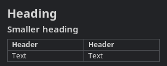
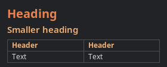
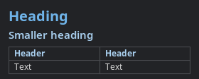
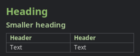
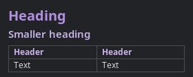

# md2nexus - mym Edit

md2nexus is a command-line tool that converts Markdown to the [BBCode](https://wiki.nexusmods.com/index.php/Formating_and_BBCode_in_Descriptions) of [Nexus Mods](https://www.nexusmods.com) description pages, a single file or a whole directory at a time. The Nexus BBCode editors are hell to use if you're writing any complex documentation.

## About This Edit

md2nexus - mym Edit is a fork of [ceejbot/md2nexus](https://github.com/ceejbot/md2nexus) by C J Silverio, maintained by Mehdi Yousfi-Monod (mym) since upstream went quiet after version 0.2.1. It keeps the `md2nexus` command and its options, so it replaces the original as is. It renders nested lists without the empty line Nexus showed before them, tables with Nexus's table tags, and can color the headings with a theme. The [changelog](https://github.com/mehdiym/md2nexus-mym/blob/latest/CHANGELOG.md) details the changes per version.

## Installation

Prebuilt executables are attached to [the releases](https://github.com/mehdiym/md2nexus-mym/releases/latest) of this edit, an archive per system (`linux-x86_64`, `macos` for Intel and Apple Silicon alike, `windows-x86_64`), and one holding them all in a folder per system, as on Nexus. Put `md2nexus`, or `md2nexus.exe` on Windows, in a folder of your `PATH`. On macOS, an executable downloaded with a browser is blocked as unsigned: run `xattr -d com.apple.quarantine md2nexus` once, or allow it in System Settings, Privacy & Security.

The executables of upstream and its Homebrew tap install the original version. With Rust installed, you can also build from source:

```shell
git clone https://github.com/mehdiym/md2nexus-mym
cd md2nexus-mym
cargo install --locked --path .

# once installed:
md2nexus --help
```

## Usage

Simplest possible usage:

```shell
md2nexus -i README.md -o README.bbcode
# or, to the clipboard (pbcopy on macOS, wl-copy or xclip -selection clipboard on Linux):
cat README.md | md2nexus | pbcopy
# and then paste into the Nexus editor
```

If you don't specify an input file, `md2nexus` reads stdin. If you don't specify an output file, it writes the converted text to stdout, and nothing else.

If the input is a _directory_, `md2nexus` converts each `.md` file in it (not in its subdirectories) to a `.bbcode` file of the same name, written to the output directory, which is created if missing, or to the current directory without `-o`. It prints the names of the converted files.

A Nexus page has no files next to it: a relative link, such as one to `CHANGELOG.md`, leads nowhere there, and `md2nexus` warns about it. Either write it as an absolute URL, as this README does, or let `--base-url <URL>` (or `-b`) prefix the relative links with the URL of your repository's files:

```shell
md2nexus -b https://github.com/<user>/<repo>/blob/<branch>/ -i README.md -o README.bbcode
```

## Color Themes

By default the output has no colors, like upstream's. `--theme <NAME>` (or `-t`) colors the headings and the header row of tables with one of these palettes, made to be read on the dark background of the Nexus: the main color goes to the `#` and `##` headings, the softer one to the smaller headings and the header row of tables. The previews show them on a background close to the Nexus's.

| Theme    | Main color | Soft color | Look                                   | Preview |
|:---------|:-----------|:-----------|:---------------------------------------|:--------|
| `none`   |            |            | no colors (the default)                |  |
| `gold`   | `#caa560`  | `#dfc99f`  | Morrowind's interface: gold, parchment |  |
| `ember`  | `#e8834e`  | `#f0b27a`  | orange and amber                       |  |
| `frost`  | `#6fb3e8`  | `#a9cfee`  | ice blue                               |  |
| `moss`   | `#8fbf6a`  | `#b8d69e`  | moss green                             |  |
| `arcane` | `#b18fe0`  | `#cbb4ec`  | violet and lavender                    |  |

```shell
md2nexus -t gold -i README.md -o README.bbcode
```

## Notes on Conversion

GitHub-flavored Markdown is supported. It is far more expressive than Nexus BBCode, a stunted BBCode variation, so some of it is approximated:

- Tables become Nexus table tags, the header row in bold, each column's alignment kept through center and right tags.
- Math and front matter (YAML, TOML) become code blocks.
- Footnotes and link references are not converted into usable links: they are written as text, their definitions at the end of the document.
- Links to a section of the page (`#usage`) become plain text: a Nexus page has no anchors. Relative links need an absolute URL or `--base-url`, see [Usage](#usage).
- BBCode has no escape: a text that looks like a Nexus tag, such as `t[i]` in inline code, gets a zero-width space after its bracket so Nexus shows it as written. It stays invisible but is copied with the text. Code blocks are left as they are.

[MDX](https://mdxjs.com) is not supported at all, as Nexus BBCode doesn't allow components or JavaScript or indeed any potentially dangerous user-generated content.

## Full Usage

```text
$ md2nexus -h
md2nexus - mym Edit: a command-line tool to convert GitHub-flavored Markdown to Nexus Mods BBCode

Usage: md2nexus [OPTIONS]

Options:
  -i, --input <PATHNAME>           Path to an input file or directory. If omitted, input is read
                                   from stdin
  -o, --output <PATHNAME>          Path to an output file or directory
  -t, --theme <THEME>              Color theme: colors the headings and the header row of tables.
                                   All the colors are made to be read on the dark background of the
                                   Nexus [default: none] [possible values: none, gold, ember, frost,
                                   moss, arcane]
  -b, --base-url <URL>             Base URL of relative links, such as a repository's
                                   'https://github.com/<user>/<repo>/blob/<branch>/'
  -c, --completions <COMPLETIONS>  Emit completion data for your preferred shell [possible values:
                                   bash, elvish, fish, powershell, zsh]
      --license                    Print GPL-3.0 license information
  -h, --help                       Print help (see more with '--help')
  -V, --version                    Print version
```

## Implementation Notes

The heavy lifting is done by the [markdown](https://lib.rs/crates/markdown) crate, which generates an AST for input documents. The tool visits the tree's nodes and generates the matching BBCode.

## License

GPL-3.0. Copyright (C) 2023 C J Silverio; mym Edit changes copyright (C) 2026 Mehdi Yousfi-Monod.
